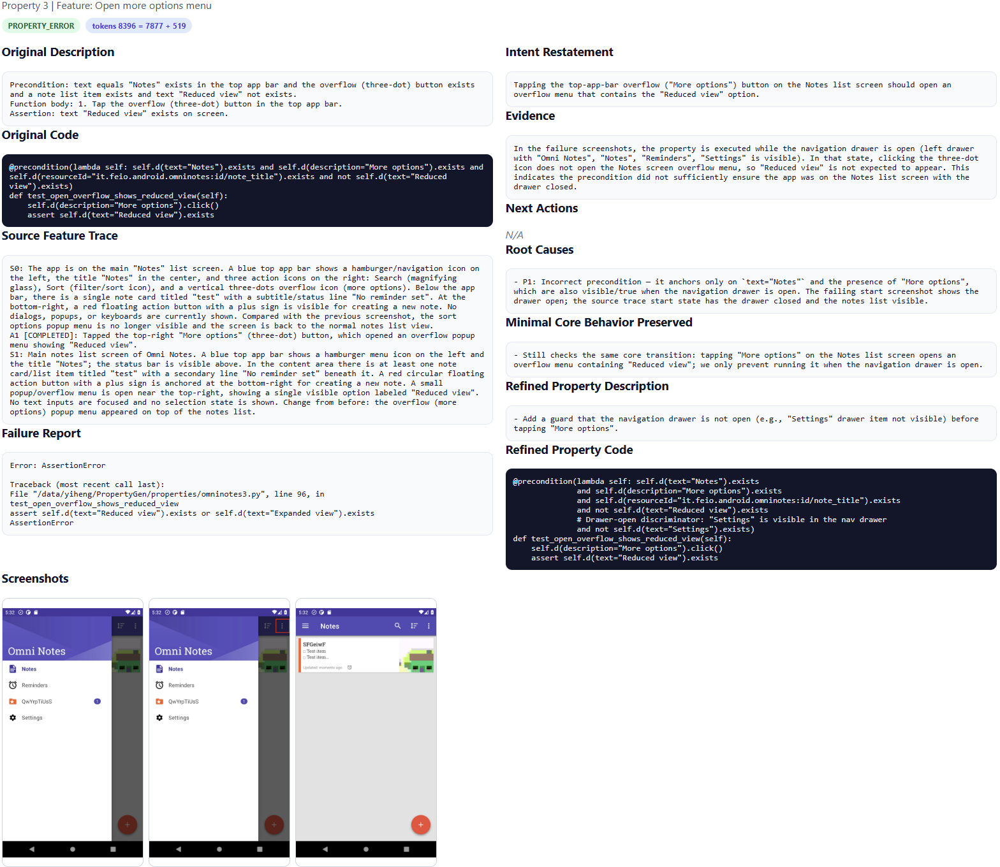

# PropGen: Automated Property Generation for Property-Based Testing of Mobile Apps

PropGen is an automated approach for generating executable properties for property-based testing of Android apps. Given an Android app, PropGen (1) performs hypothesis-driven exploration to collect behavioral evidence from app executions, (2) synthesizes executable properties from the collected evidence, and (3) refines imprecise properties based on testing feedback.

## Repository Structure

```
PropGen/
├── README.md
├── requirements.txt
├── Apk/                              # APKs of the 12 subject apps
│   ├── omninotes-6.3.1.apk
│   ├── markor-2.15.2.apk
│   └── ...                          # (one APK per subject app)
├── Evaluation/
│   ├── DroidAgent/                  # results of DroidAgent (CSV per app)
│   ├── PropGen/                     # results of PropGen (JSON per app)
│   └── bugs.md                      # List of 25 detected bugs with descriptions
└── Tool/                         # Source code
    ├── start.py                     # Main entry point (behavioral evidence construction + property synthesis)
    ├── property_refine.py           # Feedback-driven property refinement
    ├── refinement_example.html      # Interactive refinement example report
    ├── refinement_example.png       # Refinement example screenshot
    └── droidbot/                    # Core engine
```

## Requirements

### System
- **OS**: Ubuntu 22.04 (recommended)
- **Android SDK**: Android 11 (API 30), with emulator and platform-tools
- **Java**: OpenJDK 17
- **Python**: 3.9+

### Python Dependencies

```bash
pip install -r requirements.txt
```

### LLM Backend

PropGen uses **GPT-5.2** via the OpenAI API. Set your API key before running:

```bash
export OPENAI_API_KEY="your-api-key"
```

### Property-Based Testing Framework

PropGen generates properties for [Kea](https://github.com/ecnusse/Kea2), a general property-based testing framework for Android apps. Install Kea following the instructions in its repository before running property-based testing.

## Android Environment Setup

### 1. Install Java

```bash
sudo apt update
sudo apt install -y openjdk-17-jdk
java -version   # should print openjdk 17.x.x
```

### 2. Download Android Command-Line Tools

Download the latest `commandlinetools-linux` package from the [Android Studio download page](https://developer.android.com/studio#command-line-tools-only) and unzip it:

```bash
mkdir -p $HOME/Android/Sdk/cmdline-tools
unzip commandlinetools-linux-*.zip -d $HOME/Android/Sdk/cmdline-tools
mv $HOME/Android/Sdk/cmdline-tools/cmdline-tools $HOME/Android/Sdk/cmdline-tools/latest
```

### 3. Set Environment Variables

Add the following to your `~/.bashrc` (or `~/.zshrc`):

```bash
export ANDROID_HOME=$HOME/Android/Sdk
export PATH=$ANDROID_HOME/cmdline-tools/latest/bin:$PATH
export PATH=$ANDROID_HOME/platform-tools:$PATH
export PATH=$ANDROID_HOME/emulator:$PATH
```

Then reload:

```bash
source ~/.bashrc
```

### 4. Install SDK Components

```bash
sdkmanager --sdk_root=$ANDROID_HOME "platform-tools"
sdkmanager --sdk_root=$ANDROID_HOME "emulator"
sdkmanager --sdk_root=$ANDROID_HOME "platforms;android-30"
sdkmanager --sdk_root=$ANDROID_HOME "build-tools;30.0.3"
sdkmanager --sdk_root=$ANDROID_HOME "system-images;android-30;google_apis;x86_64"
```

Accept all licenses when prompted


### 5. Create an AVD

```bash
avdmanager create avd \
  --name Android11 \
  --package "system-images;android-30;google_apis;x86_64" \
  --device "pixel"
```

### 6. Verify ADB

```bash
adb version   # should print Android Debug Bridge version x.x.x
```

## Getting Started

### Step 1 — Start an Android Emulator

```bash
emulator -avd Android11 -no-snapshot &
adb wait-for-device
```

For headless environments (e.g., servers without a display):

```bash
emulator -avd Android11 -no-snapshot -no-window &
adb wait-for-device
```

### Step 2 — Run PropGen on an App

**Full pipeline** (behavioral evidence construction + property synthesis):

```bash
cd Tool/
python start.py \
  -a ../Apk/omninotes-6.3.1.apk \
  -o ./output \
  -timeout 10800 \
  -is_emulator \
  -grant_perm \
  -gen_properties
```

This runs the exploration for `-timeout` seconds (3 hours in the paper), then automatically synthesizes properties into `./output/<timestamp>/`.

**Key arguments:**

| Argument | Description |
|---|---|
| `-a <apk>` | Path to the target APK (required) |
| `-o <dir>` | Output directory |
| `-timeout <sec>` | Exploration time budget in seconds (default: 3600) |
| `-is_emulator` | Declare the target device as an emulator |
| `-grant_perm` | Grant all permissions at install time |
| `-gen_properties` | Synthesize properties after exploration finishes |
| `-gen_properties_only` | Synthesize properties from an existing exploration output (skip exploration) |
| `-d <serial>` | Target device serial (use `adb devices` to find; omit if only one device) |

**Synthesize properties from an existing exploration output** (skip re-exploration):

```bash
python start.py \
  -a ../Apk/omninotes-6.3.1.apk \
  -o ./output/<timestamp> \
  -gen_properties_only
```

### Step 3 — Run Property-Based Testing with Kea

Load the generated properties into Kea and run testing following [Kea's documentation](https://github.com/ecnusse/Kea2).

### Step 4 — Refine Imprecise Properties

After Kea reports violations, pass the failure evidence to the refinement module:

```bash
python property_refine.py \
  --property_file ./output/<timestamp>/properties.py \
  --failure_dir ./output/<timestamp>/failures \
  --apk ../Apk/omninotes-6.3.1.apk \
  --output ./output/<timestamp>/refined_properties.py
```

#### Refinement Example (OmniNotes — "Open more options menu")

The following example illustrates how PropGen repairs an imprecise property. A full interactive report is available at [`Tool/refinement_example.html`](Tool/refinement_example.html).



**Original property** — the precondition checks that the Notes screen is visible and the overflow button exists, then asserts that tapping it reveals a "Reduced view" option:

```python
@precondition(lambda self:
    self.d(text="Notes").exists and
    self.d(description="More options").exists and
    self.d(resourceId="it.feio.android.omninotes:id/note_title").exists and
    not self.d(text="Reduced view").exists)
def test_open_overflow_shows_reduced_view(self):
    self.d(description="More options").click()
    assert self.d(text="Reduced view").exists
```

**Failure** — during testing, Kea executes this property while the navigation drawer is open. In that state `text="Notes"` and `description="More options"` are both still visible, so the precondition is satisfied. However, tapping the three-dot icon when the drawer is open does not trigger the Notes-screen overflow menu, and "Reduced view" never appears — a spurious violation.

**Root cause** — the precondition is too loose: it does not guard against the navigation drawer being open, a state in which the same widgets are visible but the overflow menu behaves differently.

**Refined property** — PropGen strengthens the precondition by adding a drawer-open discriminator (`not self.d(text="Settings").exists`), which is always visible in the nav drawer but absent when the drawer is closed:

```python
@precondition(lambda self:
    self.d(text="Notes").exists and
    self.d(description="More options").exists and
    self.d(resourceId="it.feio.android.omninotes:id/note_title").exists and
    not self.d(text="Reduced view").exists and
    # Drawer-open discriminator: "Settings" is visible in the nav drawer
    not self.d(text="Settings").exists)
def test_open_overflow_shows_reduced_view(self):
    self.d(description="More options").click()
    assert self.d(text="Reduced view").exists
```

### Detected Bugs

Using the generated properties, PropGen found 25 previously unknown functional bugs across 8 apps. The full list with one-sentence descriptions is provided in [`Evaluation/bugs.md`](Evaluation/bugs.md) and in the [Detected Bugs](#detected-bugs) section below.

## Generated Property Format

Properties are written in Python using Kea's API and follow a `@precondition` / test method structure:

```python
@prob(0.5)
@precondition(lambda self:
    self.d(text="Notes").exists and
    self.d(resourceId="...id/menu_search").exists and
    self.d(resourceId="...id/note_title").exists)
def test_open_search_shows_results(self):
    self.d(resourceId="...id/menu_search").click()
    assert self.d(description="Collapse").exists
    assert self.d(resourceId="...id/search_src_text").exists
    assert self.d(resourceId="...id/note_title").exists
```

Each property corresponds to one app functionality and encodes a precondition (`P`), interaction scenario (`I`), and postcondition assertion (`Q`) as defined in the paper.

## Subject Apps

| App | Version | Feature | Link |
|---|---|---|---|
| OmniNotes | 6.3.1 | Note Manager | [Google Play](https://play.google.com/store/apps/details?id=it.feio.android.omninotes) |
| Markor | 2.15.2 | Text Editor | [GitHub](https://github.com/gsantner/markor) |
| RetroMusic | 6.6.0 | Audio Player | [Google Play](https://play.google.com/store/apps/details?id=code.name.monkey.retromusic) |
| Amaze | 3.11.1 | File Manager | [Google Play](https://play.google.com/store/apps/details?id=com.amaze.filemanager) |
| MyExpenses | 4.0.6.2 | Financial Assistant | [Google Play](https://play.google.com/store/apps/details?id=org.totschnig.myexpenses) |
| AntennaPod | 3.9.0 | Podcast Manager | [Google Play](https://play.google.com/store/apps/details?id=de.danoeh.antennapod) |
| AnkiDroid | 2.22.3 | Flashcards Manager | [Google Play](https://play.google.com/store/apps/details?id=com.ichi2.anki) |
| OuterTune | 0.10.1 | Youtube Music Player | [GitHub](https://github.com/DD3Boh/OuterTune) |
| NewPipe | 0.28.3 | Video Player | [GitHub](https://github.com/TeamNewPipe/NewPipe) |
| MaterialFiles | 1.7.4 | Storage Browser | [Google Play](https://play.google.com/store/apps/details?id=me.zhanghai.android.files) |
| Orgzly | 1.8.11 | To-do Lists Manager | [Google Play](https://play.google.com/store/apps/details?id=com.orgzly) |
| uhabits | 2.3.1 | Habit Tracker | [Google Play](https://play.google.com/store/apps/details?id=org.isoron.uhabits) |

## Detected Bugs

PropGen found 25 previously unknown functional bugs across 8 of the 12 subject apps. The table below lists each bug with a brief description.

| ID | App | Description |
|---|---|---|
| 1 | OmniNotes | Info dialog fails to display metadata (e.g., word/char count) for empty text notes. |
| 2 | OmniNotes | Reminder day labels (e.g., MON, FRI) become invisible when selected in the custom reminder dialog. |
| 3 | OmniNotes | Category default color changes unexpectedly when the user navigates color-picker tabs without confirming. |
| 4 | OmniNotes | Navigation drawer does not dismiss when the user taps the currently active item. |
| 5 | OmniNotes | Photo captured immediately after recording audio fails to appear in the note. |
| 6 | OmniNotes | The attachment menu is not dismissed when the user switches to the sketch screen, causing a UI overlay. |
| 7 | OmniNotes | Reminder icon does not appear in the note list immediately after a reminder is created via the context menu. |
| 8 | OmniNotes | An existing image attachment is silently deleted when the user discards changes after a reminder notification fires. |
| 9 | OmniNotes | A new attachment is silently dropped when added immediately after deleting the previous one. |
| 10 | OmniNotes | Floating action button incorrectly appears on the Reminders screen after the user navigates back from Settings. |
| 11 | RetroMusic | A deleted song remains visible in the Most Played list until the user navigates away and returns. |
| 12 | RetroMusic | Edited lyrics are not reflected in the UI until the user leaves and re-enters the lyrics page. |
| 13 | RetroMusic | A deleted song continues to appear in the History list until the user navigates away and returns. |
| 14 | RetroMusic | A newly set artist image is not displayed until the user navigates away and returns to the artist page. |
| 15 | RetroMusic | Resetting an artist image has no visible effect until the user leaves and re-enters the artist page. |
| 16 | RetroMusic | Updated album art is reflected in song lists but not in the active mini-player or main player. |
| 17 | Amaze | Deleting a folder on an SD card shows a "Done" notification but the folder is not actually removed. |
| 18 | OuterTune | Navigating to the Songs tab from the History tab requires two taps instead of one. |
| 19 | MaterialFiles | The file list is not refreshed after the user clears search input, leaving stale filtered results. |
| 20 | MaterialFiles | Creating a file inside a JAR archive displays a raw Java exception toast instead of a user-friendly error. |
| 21 | MaterialFiles | Deleting a folder and then accessing a stale breadcrumb entry shows a raw Java exception toast. |
| 22 | uhabits | Entering a very large number causes integer overflow, corrupting data and breaking chart rendering. |
| 23 | Orgzly | Importing a non-JSON file displays a raw Java parsing exception instead of a clear error message. |
| 24 | Markor | The Star icon state does not update when the Favourite checkbox is toggled (one-way sync only). |
| 25 | Markor | The "Insert Image" feature inserts Markdown syntax into plain `.txt` files where it has no effect. |

